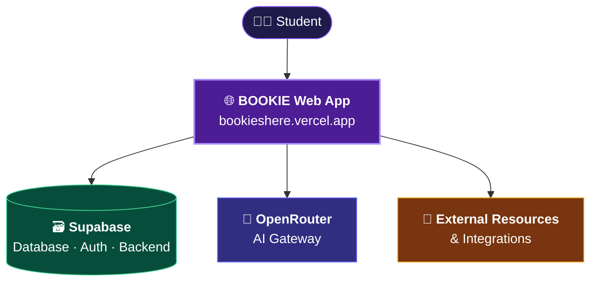

<div align="center">


# BOOKIE

**The Study & Resource Hub for Competitive Exam Aspirants**

<br/>

<a href="https://bookieshere.vercel.app">
  
</a>

<br/><br/>

[](https://bookieshere.vercel.app)
&nbsp;
[](https://bookieshere.vercel.app)


<br/>

**[✨ Visit BOOKIE](https://bookieshere.vercel.app)** &nbsp;·&nbsp; **[🚀 Quick Start](#-quick-start)** &nbsp;·&nbsp; **[🏗️ Architecture](#️-architecture)** &nbsp;·&nbsp; **[🤝 Contribute](#-contributing)**

</div>

<br/>

---

<br/>

## 📖 &nbsp;What is BOOKIE?

BOOKIE began as a simple study-material project and grew into a full platform for competitive-exam aspirants — a single place for **study resources, organized libraries, student tools, support, and an AI assistant**.

<div align="center">

> ### *Make useful study resources easier to find, easier to organize, and easier to access.*

</div>

Clean interface. Fast navigation. Organized material. No unnecessary complexity.

<br/>

---

<br/>

## ✨ &nbsp;Core Features

<table>
<tr>
<td width="50%" valign="top">

### 📚 Resource Library
A structured collection of study resources, filterable by:

- 🎯 **Exam**
- 📘 **Subject**
- 🗃️ **Resource type**
- 🔖 **Topic / chapter**
- 🧩 **Other metadata & filters**

Searchable and manageable — not an endless pile of links.

</td>
<td width="50%" valign="top">

### 🤖 AI Assistant
A built-in, study-focused assistant that helps users get around the platform and get useful answers.

- Powered by **OpenRouter**
- One unified API for multiple supported models
- Integrated directly into BOOKIE, not a bolted-on external service

</td>
</tr>
<tr>
<td width="50%" valign="top">

### 👤 User Accounts
Personalized experiences through **Supabase** authentication.

- 🪪 User profiles
- 🎛️ Personalized platform features
- 💾 Saved / associated user data
- 🔐 Account-based functionality

</td>
<td width="50%" valign="top">

### 🗂️ Organized Portal
More than a download page. Resources, tools, and educational content live in **dedicated sections**, so the whole ecosystem is navigable from one place.

</td>
</tr>
<tr>
<td colspan="2" valign="top">

### 💬 Support
Having trouble with a resource, a broken link, your account, or the platform itself? BOOKIE has dedicated support functionality, with external channels such as **Telegram** where applicable.

</td>
</tr>
</table>

<br/>

---

<br/>

## 🧭 &nbsp;Design Principles

<div align="center">

| | Principle | What it means |
|:-:|:-:|:--|
| 🪶 | **Simple** | The interface stays easy to understand. |
| 🗄️ | **Organized** | Resources are structured, never dumped. |
| 🎓 | **Student-Focused** | Every feature solves a real aspirant problem. |
| ⚡ | **Fast** | Pages and resources stay quick to open. |
| 🔧 | **Maintainable** | New resources and features slot in without a rebuild. |

</div>

<br/>

---

<br/>

## 🛠️ &nbsp;Technology Stack

<div align="center">

<a href="https://vercel.com"></a>
<a href="https://supabase.com"></a>
<a href="https://openrouter.ai"></a>

</div>

| Layer | Technology | Role |
|:--|:--|:--|
| 🖥️ **Application** | Vercel | Serves the app as an independent web application |
| 🗃️ **Data & Backend** | Supabase | Database-driven features, accounts, authentication |
| 🧠 **AI** | OpenRouter | Access to supported language models via one API |
| 🚀 **Deployment** | Vercel | Production hosting |

> 💡 **Origin story:** BOOKIE was first prototyped on **Lovable**. It has since moved on — the current version is **fully independent**, deployed and maintained on its own.

<br/>

---

<br/>

## 🏗️ &nbsp;Architecture

The main app stays cleanly separated from its database, AI provider, and external integrations.



<br/>

---

<br/>

## 🚀 &nbsp;Quick Start

**1 · Clone & install**

```bash
git clone <repository-url>
cd <repository-name>
npm install
```

**2 · Configure your environment** *(see below)*

**3 · Run the dev server**

```bash
npm run dev
```

The dev server starts locally and prints the URL to open. ✅

<br/>

---

<br/>

## 🔐 &nbsp;Environment Configuration

BOOKIE connects to **Supabase** and **OpenRouter**. Keep all configuration in environment variables — never hard-code it.

```env
# ── Supabase ─────────────────────────────
SUPABASE_URL=your_supabase_url
SUPABASE_ANON_KEY=your_supabase_anon_key

# ── OpenRouter ───────────────────────────
OPENROUTER_API_KEY=your_openrouter_api_key
```

> [!NOTE]
> Use the **exact variable names** expected by the current application when setting up your local environment or Vercel project.

> [!CAUTION]
> **Never commit** private API keys, service-role keys, passwords, or any other secrets to the repository.

<br/>

---

<br/>

## ☁️ &nbsp;Production Deployment

BOOKIE is deployed on **Vercel**.

<div align="center">

[](https://bookieshere.vercel.app)

</div>

Before deploying, make sure every required environment variable is added in your **Vercel project settings**.

<br/>

---

<br/>

## 🛡️ &nbsp;Data & Privacy

- 🗃️ Application and account data is handled through **Supabase**.
- 🔑 Sensitive credentials and private keys never belong in frontend source code or Git.
- 🪙 Only the **minimum data required** for platform functionality is stored.

<br/>

---

<br/>

## ⚖️ &nbsp;Resource & Copyright Disclaimer

BOOKIE exists to help students **discover and organize** educational resources.

- A resource appearing on the platform does **not** imply BOOKIE owns it.
- Users are responsible for respecting applicable copyright, licensing, and intellectual-property laws.
- Where appropriate, resources are removed or updated in response to **valid rights-holder requests**.

<br/>

---

<br/>

## 🤝 &nbsp;Contributing

Bug reports, feature ideas, and improvements are all welcome. Before submitting changes:

1. 🎨 Keep the existing design and usability principles in mind.
2. 🔒 Don't expose credentials or sensitive configuration.
3. 🧪 Test your changes locally before deployment.
4. 🎯 Keep new features focused on genuine student needs.

<br/>

---

<br/>

## 📍 &nbsp;Project Status

BOOKIE is **actively developed**. Features, resource categories, AI functionality, and backend systems will keep evolving as the project grows.

For the latest version, always visit **[bookieshere.vercel.app](https://bookieshere.vercel.app)**.

<br/>

---

<div align="center">

<br/>

### 📚 **BOOKIE**

**Organized. &nbsp;Simple. &nbsp;Student-Focused.**

<sub>Made for students who would rather spend time studying<br/>than searching through seventeen different Telegram chats for one PDF.</sub>

<br/>

[](https://bookieshere.vercel.app)

<br/>


</div>
